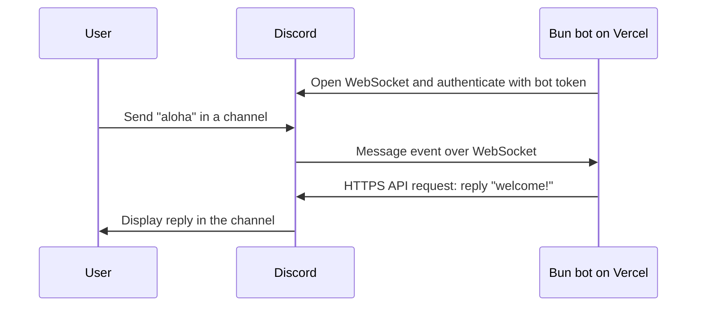

# notifier

Bun bot for the Operations Discord server (`1048891178008973312`), application `1048889942148907049`.

See the [reactor README](../reactor/README.md) for the separate bot that handles `/info` and `/me` through HTTP interaction callbacks.

- `/ping` replies `pong!`.
- `/mood` posts a 24-hour poll asking “How are you feeling?” with `good`, `ok`, and `bad` options. Each person can choose one answer. The bot needs **Send Polls** permission in the channel.
- `/life` uploads the vendored glider image from `assets/glider.png` into the chat. The bot needs **Attach Files** permission in the channel.
- `/greet` opens a popup with required Firstname and Surname fields. Submitting it posts `Welcome, {Firstname} {Surname}!` in the channel.
- `/me` replies `I am Notifier`.
- `/links` shows link buttons for `demin.ws` and `demin.page`. Discord controls how links open in the browser; the bot cannot force a new tab.
- A user message containing the whole word `aloha` (case insensitive) gets a `welcome!` reply in the same channel.
- Bot/webhook messages and other servers are ignored. Replies do not ping users.

## Discord terminology

A **Discord application (app)** is the developer-side container for an integration. It holds the application ID and settings, its bot user and token, slash-command registrations, and interaction-delivery configuration.

This application's ID is `1048889942148907049`; its bot user is **notifier**. The deployed Bun code logs in as that bot user.

A **guild** is Discord's API term for a **server**. **Operations** is our guild, with ID `1048891178008973312`. It contains channels such as `#general`, members, and roles.

```text
Application
└── Bot user: notifier
    └── Installed in guild: Operations
        └── Channel: #general
```

One application's bot can be installed in multiple guilds. A **global command** belongs to the application across its installations; a **guild command** is registered for one specific server. Our `/ping` is currently a guild command for Operations.

## Hosting

`https://discord-responder.vercel.app` serves a small Bun HTTP service. `/health` checks the HTTP service only; inspect the `discord` daemon logs for Discord connectivity.

The bot runs separately as one Vercel Daemon in London using the Bun Docker image. A persistent Gateway connection receives both slash commands and messages. Ordinary request-scoped functions cannot keep this bot connected continuously. Daemons are a Vercel beta and run only in production. Keep one instance to avoid duplicate replies.

References: [Vercel Daemons](https://vercel.com/docs/daemons), [Bun runtime](https://vercel.com/docs/functions/runtimes/bun), [Discord Gateway](https://docs.discord.com/developers/events/gateway).

## How messages reach the bot

The daemon opens an outbound WebSocket connection to Discord and keeps it alive with heartbeats. Discord pushes events through that connection; the bot sends replies through Discord's HTTPS API. `discord.js` handles heartbeats and reconnection.



`/ping` also arrives over the Gateway as an interaction event. The Interactions Endpoint URL is empty, so Discord does not POST commands to the website. The website's health endpoint runs separately from the daemon.

## Discord configuration

1. Open the application in the [Discord Developer Portal](https://discord.com/developers/applications/1048889942148907049/bot).
2. Under Bot, enable **Message Content Intent**.
3. Install the bot with the `bot` and `applications.commands` scopes and View Channels, Send Messages, Read Message History, and Send Messages in Threads permissions:
   [Install in Operations](https://discord.com/oauth2/authorize?client_id=1048889942148907049&scope=bot%20applications.commands&permissions=274877975552&guild_id=1048891178008973312&disable_guild_select=true).
4. Leave **Interactions Endpoint URL empty**: this bot handles commands over the Gateway.
5. Ensure channel permission overrides allow the bot to read and reply. Private threads also require membership.

On startup the bot upserts `/ping`, `/me`, `/links`, `/greet`, `/life`, and `/mood` in the configured server, preserving other commands.

## Local development

Run all commands below from the `notifier/` directory. Its `.env`, dependencies, Justfile, and Vercel project link are local to this folder.

```sh
bun install
cp .env.example .env
# Fill in DISCORD_BOT_TOKEN in .env.
bun run bot
```

Run `bun run dev` separately for the HTTP service at localhost:3000. Do not run the local bot while the production daemon is active: both connections would reply.

```sh
bun test
bun run typecheck
```

## Operating commands

With Bun, Vercel CLI, and `just` installed, run `just` to list the recipes in `Justfile`.

| Command | Purpose |
| --- | --- |
| `just install` | Install locked dependencies |
| `just dev` | Run the local HTTP service with reload |
| `just bot` | Run the local Discord bot; stop with Ctrl+C |
| `just commands-global` | List global Discord commands and their options |
| `just commands-server` | List commands and their options in the configured server |
| `just send-message` | Post `ok` to `#general` as the bot |
| `just webhook-msg` | Post `ok` through the messenger webhook to `#general` |
| `just check` | Run tests and TypeScript checks |
| `just link` | Link to the existing Vercel project |
| `just deploy` | Check and deploy the HTTP service and daemon |
| `just health` | Check the production HTTP endpoint |
| `just status` | Show production daemon readiness and instance counts |
| `just logs` | Show recent production HTTP logs |
| `just dashboard` | Print the dashboard link for daemon logs and scaling |

Override the message with `just send-message 123` or `just send-message "Hello there!"`. This command reads credentials from `.env` and posts directly through Discord's REST API; no daemon or custom HTTP endpoint is needed. Mentions are disabled. It resolves the unique `#general` text channel in the configured server.

The webhook example uses only `DISCORD_WEBHOOK_URL` from `.env`, without a bot token or running daemon:

```sh
just webhook-msg                # sends "ok"
just webhook-msg 123             # sends "123"
just webhook-msg "Hello there!"  # custom message
```

The webhook's Discord configuration determines the sender name (`messenger`) and destination (`#general`). Mentions are disabled and the script waits for Discord to confirm delivery. Keep the complete webhook URL secret: it contains the credential that allows posting. Only an empty placeholder belongs in `.env.example`; no Vercel environment change or deployment is needed for this local command.

For daemon logs, open **Daemons → discord** in the Vercel dashboard. The installed CLI's `logs` command supports HTTP logs only. To stop the production bot, set the daemon's scaling override to zero instances. Clear that override to resume the configured single instance; overrides persist across deployments. Stop production before running `just bot` locally to avoid duplicate replies.

## Deployment

Production needs `DISCORD_BOT_TOKEN`, `DISCORD_APPLICATION_ID`, and `DISCORD_GUILD_ID` in Vercel environment variables. `.env` files are excluded from Git, Docker and deployment uploads. Never commit the bot token.

```sh
vercel link --project discord-bot
vercel env add DISCORD_BOT_TOKEN production --sensitive
vercel env add DISCORD_APPLICATION_ID production
vercel env add DISCORD_GUILD_ID production
vercel deploy --prod
```

After changing environment variables, redeploy to refresh the daemon. Inspect the production logs for `Connected as` and `Registered /ping`. Test `/ping` and send `aloha!` from a human Discord account; bots are deliberately ignored.
